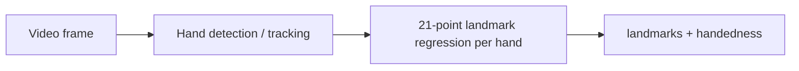

# MediaPipe Hand Landmarker — Model Reference

เอกสารนี้อธิบายโมเดลที่ Air Cursor ใช้สำหรับ hand / finger pose estimation  
สำหรับ pipeline ทั้งแอป ดู [technical-overview.md](./technical-overview.md)  
สำหรับคำศัพท์ domain ดู [CONTEXT.md](../CONTEXT.md)

---

## สรุป

Air Cursor **ไม่ได้ train โมเดลเอง** — ใช้ **Google MediaPipe Hand Landmarker** ผ่าน `@mediapipe/tasks-vision` (ในโปรเจกต์: `^0.10.35`)

Task นี้ให้ **21 landmarks ต่อมือ** (ข้อมือ + สามข้อแต่ละนิ้ว) ในระบบพิกัด normalized บนเฟรมวิดีโอ พร้อม **handedness** (ซ้าย/ขวา)

Air Cursor ใช้หลัก ๆ:

- **Landmark 8** (ปลายนิ้วชี้) → Aim Point  
- **Landmark 4 + 8** (ปลายโป้ง + ปลายชี้) → ระยะ Pinch (click / drag)  
- **21 จุดทั้งหมด** → วาด skeleton บน Tracking Panel  

**Pinch ไม่ได้มาจาก Gesture Recognizer** — คำนวณจากระยะระหว่างจุดใน [`activeHandFilter.ts`](../apps/web/src/vision/activeHandFilter.ts)

---

## โมเดลที่โหลดในโค้ด

ไฟล์: [`apps/web/src/vision/handLandmarker.ts`](../apps/web/src/vision/handLandmarker.ts)

| รายการ | ค่า |
|--------|-----|
| Task | **Hand Landmarker** (MediaPipe Tasks Vision) |
| ไฟล์โมเดล | `hand_landmarker.task` |
| URL | `https://storage.googleapis.com/mediapipe-models/hand_landmarker/hand_landmarker/float16/1/hand_landmarker.task` |
| ความแม่นยำน้ำหนัก | **float16** |
| WASM runtime | `https://cdn.jsdelivr.net/npm/@mediapipe/tasks-vision@latest/wasm` |
| `runningMode` | `VIDEO` → `detectForVideo(video, timestamp)` |
| `numHands` | `2` (filter มือเดียวใน app ตาม Active Hand) |
| Delegate | `GPU` ก่อน, fallback `CPU` |

```ts
HandLandmarker.createFromOptions(vision, {
  baseOptions: {
    modelAssetPath: MODEL_URL,
    delegate: 'GPU' | 'CPU',
  },
  runningMode: 'VIDEO',
  numHands: 2,
})
```

ไฟล์ `.task` เป็น **bundle ที่ Google แพ็กไว้** (โมเดลย่อยหลายส่วนใน pipeline เดียว) — ไม่ใช่โมเดล “นิ้วอย่างเดียว” แต่เป็น **มือทั้ง只 21 จุด**

**เอกสารทางการ:** [Hand Landmarker — Web/JS](https://developers.google.com/mediapipe/solutions/vision/hand_landmarker/web_js)

**ADR ในโปรเจกต์:** [0001-client-side-mediapipe-hands.md](./adr/0001-client-side-mediapipe-hands.md)

---

## Pipeline โดยประมาณ

MediaPipe ไม่เปิดรายละเอียด layer ใน repo นี้ แต่ Hand Landmarker สืบทอดจาก **MediaPipe Hands** แบบคลาสสิก:



1. **หามือในเฟรม** — detection + tracking ข้ามเฟรม (โหมด `VIDEO`)  
2. **ถอยพิกัด 21 จุด** ต่อมือ  
3. คืน **handedness** ต่อมือ  

ไม่รวม pose ทั้งตัวหรือใบหน้า (ต่างจาก **Holistic Landmarker**)

---

## Output ของโมเดล

จาก `HandLandmarkerResult` (`@mediapipe/tasks-vision`):

| ฟิลด์ | ความหมาย | Air Cursor |
|--------|----------|------------|
| `landmarks` | 21 จุด/มือ — `x`, `y` normalized [0,1], มี `z`, `visibility` | ใช้ **x, y** เท่านั้นใน `parseResult` |
| `worldLandmarks` | พิกัด 3D (เมตร) | **ไม่ใช้** |
| `handedness` | Left / Right + confidence | ใช้ `pickActiveHand` |

### NormalizedLandmark (จาก MediaPipe)

- `x`, `y` — 0–1 เทียบความกว้าง/สูงของภาพ  
- `z` — ความลึกสัมพัทธ์ (ยิ่งเล็กยิ่งใกล้กล้อง)  
- `visibility` — ความน่าจะเป็นที่จุดมองเห็นในภาพ  

หลัง parse แล้ว Air Cursor ใช้ [`mirrorLandmarks`](../apps/web/src/vision/mirrorSpace.ts) (`x → 1 - x`) ให้สอดคล้องกับวิดีโอ `scaleX(-1)` บน Tracking Panel

---

## 21 landmarks — ดัชนีมาตรฐาน

โครงเดียวกับ `HandLandmarker.HAND_CONNECTIONS` และ [`drawSkeleton.ts`](../apps/web/src/overlay/drawSkeleton.ts):

| Index | ตำแหน่ง |
|-------|--------|
| 0 | Wrist (ข้อมือ) |
| 1–4 | Thumb (ฐาน → ปลาย) |
| 5–8 | Index (ฐาน → ปลาย) |
| 9–12 | Middle |
| 13–16 | Ring |
| 17–20 | Pinky |

**ที่ Air Cursor อ้างอิงโดยตรง:**

| Index | ใช้ทำ |
|-------|--------|
| 4 | Thumb tip — Pinch |
| 8 | Index tip — Aim Point, calibration |

---

## Options (MediaPipe defaults vs โปรเจกต์)

จาก `HandLandmarkerOptions` — โปรเจกต์กำหนดเฉพาะ `numHands: 2`:

| Option | Default | ความหมาย |
|--------|---------|----------|
| `numHands` | 1 | จำนวนมือสูงสุดต่อเฟรม (**เรา = 2**) |
| `minHandDetectionConfidence` | 0.5 | คะแนนขั้นต่ำเมื่อเจอมือใหม่ |
| `minHandPresenceConfidence` | 0.5 | มือยังอยู่ในเฟรม |
| `minTrackingConfidence` | 0.5 | คุณภาพ tracking ต่อเฟรม |

ปรับได้ผ่าน `setOptions()` หรือ `createFromOptions` ถ้าต้องการลด false positive / เพิ่มเสถียรภาพ

---

## สิ่งที่โมเดลไม่ได้ทำใน Air Cursor

- ไม่ estimate **3D hand mesh** (เช่น MANO)  
- ไม่ classify **ท่ามือสำเร็จรูป** (OK, Peace) — ใช้ระยะ pinch แทน  
- ไม่ map ไป UI โดยตรง — แอป **calibrate** แล้ว `mapToCanvas` เอง  
- ไม่ใช้ `z` / `visibility` จาก output  

---

## เปรียบเทียบ MediaPipe tasks ที่เกี่ยวข้อง

| Task | Output หลัก | เหมาะเมื่อ |
|------|-------------|------------|
| **Hand Landmarker** ← ใช้อยู่ | 21 จุด + handedness | ชี้, skeleton, pinch แบบกำหนดเอง |
| **Gesture Recognizer** | landmarks + gesture class | ท่ามือ predefined |
| **Holistic Landmarker** | มือ + ใบหน้า + pose | ทั้งร่าง |

---

## การไหลข้อมูลใน Air Cursor (หลังโมเดล)

```
detectForVideo(video, timestamp)
  → parseResult (x, y + handedness label)
  → pickActiveHand(activeHand)
  → mirrorLandmarks
  → smooth(index tip)
  → mapToCanvas (เมื่อ calibrated)
  → pinchDistance(thumb, index) → PinchDetector
```

จุดเชื่อมในโค้ด: [`App.tsx`](../apps/web/src/App.tsx) (rAF loop)

---

## Dependencies

| Package | บทบาท |
|---------|--------|
| `@mediapipe/tasks-vision` | Hand Landmarker API + WASM |
| โมเดลบน `storage.googleapis.com` | โหลดครั้งแรกตอนรัน (ต้องมีเน็ต) |

---

*อัปเดตตาม `apps/web/src/vision/handLandmarker.ts` และ `@mediapipe/tasks-vision` ใน `package.json`*
