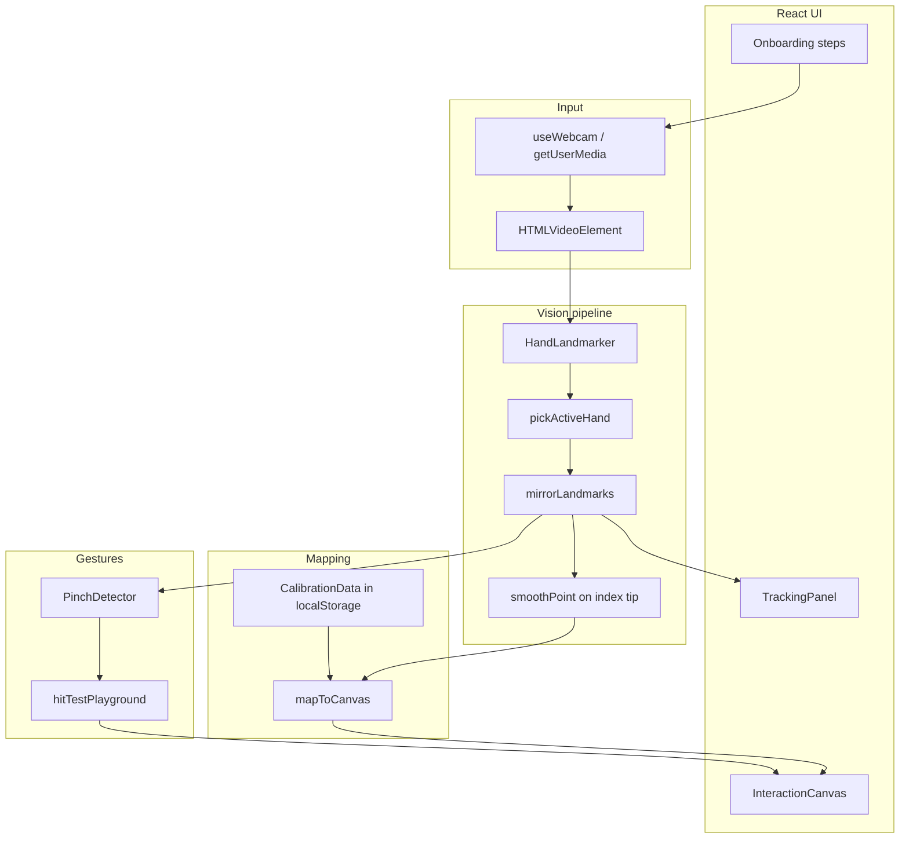
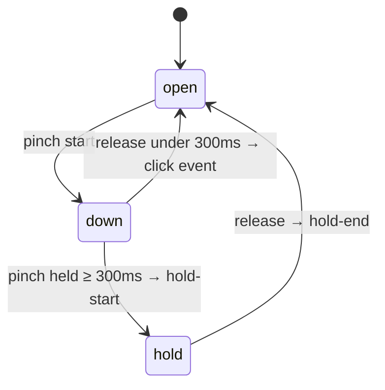

# Air Cursor — Technical Overview

เอกสารนี้อธิบายว่าแอป web demo ทำงานอย่างไร และชี้ไปที่ไฟล์ในโค้ดที่รับผิดชอบแต่ละส่วน  
สำหรับคำศัพท์ธุรกิจ (Interaction Canvas, Aim Point, Pinch ฯลฯ) ดู [CONTEXT.md](../CONTEXT.md)

---

## 1. ภาพรวม

Air Cursor เป็นแอป React ที่รันในเบราว์เซอร์เท่านั้น:

1. เปิดกล้องผ่าน `getUserMedia`
2. ตรวจจับมือด้วย **MediaPipe Hand Landmarker** (21 จุดต่อมือ)
3. ใช้ **ปลายนิ้วชี้** (landmark 8) เป็นตำแหน่งชี้
4. แปลงตำแหน่งนิ้ว → พิกัดบน **Interaction Canvas** แบบ absolute (หลัง calibration)
5. ใช้ **Pinch** (นิ้วโป้ง + ชี้เข้าหากัน) เป็น click / drag

วิดีโอไม่อัปโหลดออกจากเครื่อง — inference ทำใน WASM บน client

---

## 2. สถาปัตยกรรมระดับสูง



**จุดรวมศูนย์:** [`apps/web/src/App.tsx`](../apps/web/src/App.tsx) — state, onboarding, และ `requestAnimationFrame` loop หลัก

---

## 3. โครงสร้างโปรเจกต์

```
air-cursor/
├── CONTEXT.md                 # glossary
├── AGENTS.md                  # คำแนะนำสำหรับ agent
├── docs/
│   ├── README.md
│   ├── technical-overview.md  # เอกสารนี้
│   └── adr/
└── apps/web/
    ├── src/
    │   ├── App.tsx            # orchestration + rAF loop
    │   ├── types.ts           # types + default tunables
    │   ├── camera/
    │   │   └── useWebcam.ts
    │   ├── vision/
    │   │   ├── handLandmarker.ts
    │   │   ├── activeHandFilter.ts
    │   │   ├── mirrorSpace.ts
    │   │   └── smooth.ts
    │   ├── calibration/
    │   │   ├── storage.ts
    │   │   └── mapToCanvas.ts
    │   ├── gestures/
    │   │   └── pinchDetector.ts
    │   ├── overlay/
    │   │   └── drawSkeleton.ts
    │   ├── playground/
    │   │   ├── InteractionCanvas.tsx
    │   │   ├── hitTest.ts
    │   │   ├── PlaygroundButton.tsx
    │   │   └── DraggableCard.tsx
    │   └── ui/
    │       ├── TrackingPanel.tsx
    │       ├── VirtualPointer.tsx
    │       ├── DevTunables.tsx      # Leva, dev only
    │       └── onboarding/
    └── package.json
```

---

## 4. Onboarding

สถานะอยู่ที่ `onboarding: OnboardingStep` ใน `App.tsx`

| Step | UI | เงื่อนไขถัดไป |
|------|-----|----------------|
| `permission` | [`PermissionStep.tsx`](../apps/web/src/ui/onboarding/PermissionStep.tsx) | ได้ camera stream → `advanceAfterCamera()` |
| `hand-pick` | [`HandPickStep.tsx`](../apps/web/src/ui/onboarding/HandPickStep.tsx) | เลือก `left` / `right` → `calibrate` |
| `calibrate` | [`CalibrateStep.tsx`](../apps/web/src/ui/onboarding/CalibrateStep.tsx) | เก็บ bounds 5 วินาที → `ready` |
| `ready` | Tracking + Interaction Canvas | — |

**Camera กับ `<video>`:** ตอน `permission` / `hand-pick` ยังไม่มี `TrackingPanel` จึงมี `<video>` ซ่อนใน `App.tsx` เพื่อผูก stream ([`useWebcam.ts`](../apps/web/src/camera/useWebcam.ts))  
ตอน `calibrate` / `ready` ใช้ `<video>` ใน [`TrackingPanel.tsx`](../apps/web/src/ui/TrackingPanel.tsx)

**ข้าม onboarding:** ถ้า [`loadCalibration()`](../apps/web/src/calibration/storage.ts) คืนค่าได้ (version ตรง) หลังเปิดกล้องจะไป `ready` เลย

---

## 5. กล้อง — `useWebcam`

ไฟล์: [`apps/web/src/camera/useWebcam.ts`](../apps/web/src/camera/useWebcam.ts)

| Export | หน้าที่ |
|--------|--------|
| `requestAccess()` | `getUserMedia` → เก็บ stream → `isReady = true` |
| `videoRef` | callback ref ผูก stream กับ `<video>` |
| `videoElementRef` | ใช้ใน rAF loop ส่งเข้า MediaPipe |
| `stream` | `MediaStream` ปัจจุบัน |

- Auto-start ถ้า `navigator.permissions` รายงาน `camera: granted`
- `video.play()` ล้มเหลวไม่ reset `isReady` — stream ยังใช้กับ MediaPipe ได้

---

## 6. Vision pipeline (ทุกเฟรมวิดีโอ)

Loop อยู่ใน `App.tsx` (`useEffect` เมื่อ `trackingActive === true`)

### 6.1 เงื่อนไขรัน loop

```ts
trackingActive =
  isReady &&
  onboarding !== 'permission' &&
  onboarding !== 'hand-pick'
```

### 6.2 ขั้นตอนต่อเฟรม

1. **ข้ามเฟรมซ้ำ** — ประมวลผลเมื่อ `video.currentTime` เปลี่ยน
2. **`detectForVideo(video, timestamp)`** — [`handLandmarker.ts`](../apps/web/src/vision/handLandmarker.ts)
3. **`parseResult`** — แปลงเป็น `landmarksList` + `handednessList`
4. **`pickActiveHand`** — เลือกมือตาม `activeHand` จาก onboarding ([`activeHandFilter.ts`](../apps/web/src/vision/activeHandFilter.ts))
5. **`mirrorLandmarks`** — flip แกน X ให้ตรงกับวิดีโอ mirror ([`mirrorSpace.ts`](../apps/web/src/vision/mirrorSpace.ts))
6. **Index tip (landmark 8)** → `smoothPoint` (EMA) → `indexTipRef`
7. **Pinch** — ระยะระหว่าง landmark 4 (thumb) กับ 8 เทียบ `pinchThreshold`
8. ถ้า `onboarding === 'ready'` และมี `calibration` → `mapToCanvas` → `aimPoint` + hit-test + pinch events

### 6.3 MediaPipe setup

ไฟล์: [`handLandmarker.ts`](../apps/web/src/vision/handLandmarker.ts)

- โหลด WASM จาก jsDelivr CDN
- โมเดล `hand_landmarker.task` จาก Google storage
- `numHands: 2` แล้ว filter ฝั่ง app
- `delegate: 'GPU'` ล้มเหลวจะ fallback `CPU` (ช่วย Safari)

รายละเอียดโมเดล (21 landmarks, output, pipeline, เปรียบเทียบ tasks): **[hand-landmarker-model.md](./hand-landmarker-model.md)**

ดู ADR: [0001-client-side-mediapipe-hands.md](./adr/0001-client-side-mediapipe-hands.md)

### 6.4 Landmarks ที่ใช้

| Index | นิ้ว | ใช้ทำอะไร |
|-------|------|-----------|
| 4 | Thumb tip | Pinch distance |
| 8 | Index tip | Aim Point, calibration sampling |

ค่าพิกัดจาก MediaPipe เป็น **normalized** `[0, 1]` เทียบกับเฟรมวิดีโอ

---

## 7. Mirror space (ให้ตรงกับกระจก)

วิดีโอแสดงด้วย CSS `transform: scaleX(-1)` บน [`TrackingPanel`](../apps/web/src/ui/TrackingPanel.tsx)

หลัง detect มือ ทุก landmark ผ่าน:

```ts
// mirrorSpace.ts
{ x: 1 - p.x, y: p.y }
```

ใช้พิกัดหลัง mirror สำหรับ:

- วาด skeleton
- เก็บ calibration (min/max ของ index tip)
- แมป Aim Point

**Calibration version:** `CALIBRATION_VERSION = 2` ใน [`types.ts`](../apps/web/src/types.ts) — calibration เก่าก่อน mirror จะถูกละเว้น

---

## 8. Calibration

### 8.1 พิธี (5 วินาที)

[`CalibrateStep.tsx`](../apps/web/src/ui/onboarding/CalibrateStep.tsx) วน `requestAnimationFrame` เก็บ min/max ของ `indexTipRef` (พิกัด mirror แล้ว)

บันทึกเป็น:

```ts
interface CalibrationData {
  version: 2
  hand: 'left' | 'right'
  minX, maxX, minY, maxY  // ขอบเขตการขยับนิ้วใน normalized space
}
```

เก็บใน `localStorage` key `air-cursor-calibration` — [`storage.ts`](../apps/web/src/calibration/storage.ts)

### 8.2 แมปไป Interaction Canvas

ไฟล์: [`mapToCanvas.ts`](../apps/web/src/calibration/mapToCanvas.ts)

```
nx = (point.x - minX) / (maxX - minX)
ny = (point.y - minY) / (maxY - minY)
```

จากนั้นใส่ **dead zone** รอบศูนย์กลาง (`deadZone`, default 0.02) เพื่อลดสั่นเมื่อนิ้วนิ่ง  
สุดท้ายคูณด้วย `width` / `height` ของ DOM container (`canvasRef` ใน `App.tsx`) แล้ว clamp

นี่คือการแมปแบบ **absolute (Wacom-style)** — มุมซ้ายบนของกรอบมือ ≈ มุมซ้ายบนของ canvas

---

## 9. Smoothing

ไฟล์: [`smooth.ts`](../apps/web/src/vision/smooth.ts)

Exponential moving average บนตำแหน่ง index tip เท่านั้น:

```
smoothed = prev + α * (next - prev)    // α = tunables.smoothing (default 0.35)
```

---

## 10. Pinch — click และ drag

ไฟล์: [`pinchDetector.ts`](../apps/web/src/gestures/pinchDetector.ts)

**ตรวจจับ pinch:** `pinchDistance(thumb, index) < pinchThreshold` (default 0.045 ใน normalized space)

**State machine:**



| Event | การทำงานใน App.tsx |
|-------|---------------------|
| `click` | ถ้า `hoverId` เป็นปุ่ม → เพิ่ม `buttonPressCounts` |
| `hold-start` | ถ้า `hoverId` เป็นการ์ด → เริ่ม drag, เก็บ offset จาก Aim Point |
| `hold-end` | หยุด drag |

ระหว่าง drag: อัปเดต `cards[].x/y` จาก `mapped.x - dragOffset` ทุกเฟรมที่ยัง pinch ค้าง

---

## 11. Interaction Canvas และ hit-test

ไฟล์หลัก:

- [`InteractionCanvas.tsx`](../apps/web/src/playground/InteractionCanvas.tsx) — layout ปุ่ม / การ์ด / [`VirtualPointer.tsx`](../apps/web/src/ui/VirtualPointer.tsx)
- [`hitTest.ts`](../apps/web/src/playground/hitTest.ts) — `pointInRect`, `findTargetAt` (วาดทับจากหลังไปหน้า)

**Hover:** `hitTestPlayground(aimPoint, buttons, cards)` → `hoveredId` → UI scale / glow

**สำคัญ:** Aim Point แสดงเฉพาะบน Interaction Canvas ไม่ทับ Tracking Panel (ตาม CONTEXT)

---

## 12. Tracking Panel

[`TrackingPanel.tsx`](../apps/web/src/ui/TrackingPanel.tsx)

- `<video>` mirror + `<canvas>` วาดทับ
- [`drawSkeleton.ts`](../apps/web/src/overlay/drawSkeleton.ts) — เส้น 21 จุด, index tip เน้นสีม่วง
- `showGuide` — กรอบประ during calibration

---

## 13. Tunables (พัฒนาเท่านั้น)

[`DevTunables.tsx`](../apps/web/src/ui/DevTunables.tsx) — Leva panel เมื่อ `import.meta.env.DEV` และไม่ใช่หน้า permission

| พารามิเตอร์ | Default | ผล |
|-------------|---------|-----|
| `smoothing` | 0.35 | ความลื่นของ Aim Point |
| `pinchThreshold` | 0.045 | ความไว pinch |
| `deadZone` | 0.02 | ลด jitter ตรงกลาง normalized space |

---

## 14. ไดอะแกรมข้อมูลหนึ่งเฟรม (ready mode)

```
Video frame
    → HandLandmarker.detectForVideo
    → pickActiveHand(activeHand)
    → mirrorLandmarks
    ├→ setLandmarks → drawSkeleton (Tracking Panel)
    └→ smooth(index tip)
           → mapToCanvas(calibration, canvas size)
           → aimPoint → VirtualPointer + hitTest
           pinchDistance → PinchDetector
               → click / drag on playground
```

---

## 15. Dependencies

| Package | บทบาท |
|---------|--------|
| `react` + `vite` | UI + build |
| `@mediapipe/tasks-vision` | Hand Landmarker |
| `motion` | animation ปุ่ม/การ์ด |
| `leva` | debug sliders (dev) |
| `tailwindcss` v4 | styling |

---

## 16. รันและทดสอบ

```bash
cd apps/web
npm install
npm run dev
```

- ต้องใช้ **localhost** หรือ **HTTPS** สำหรับกล้อง
- เป้าหมายเบราว์เซอร์: Chrome + Safari (macOS)
- หลังเปลี่ยน mirror logic: กด **Recalibrate** ถ้า pointer เพี้ยน

---

## 17. ข้อจำกัด MVP (ตั้งใจไว้)

- ไม่ควบคุม OS mouse / ไม่มี Electron
- ไม่มี voice command
- Hit-test เป็น bounding box แบบง่าย ไม่ใช่ DOM pointer events
- Playground object ตำแหน่งเริ่มต้น hardcode ใน `App.tsx`

---

## 18. แนวทางขยาย (ยังไม่ implement)

- Slider / mini-game บน Interaction Canvas
- Desktop bridge (Tauri + global cursor)
- แยก `pointer/` module ตามโครงใน plan เดิมถ้า logic โตขึ้น

---

*อัปเดตตาม codebase ใน `apps/web` — ถ้าโครงสร้างเปลี่ยน แก้เอกสารนี้คู่กับ PR*
